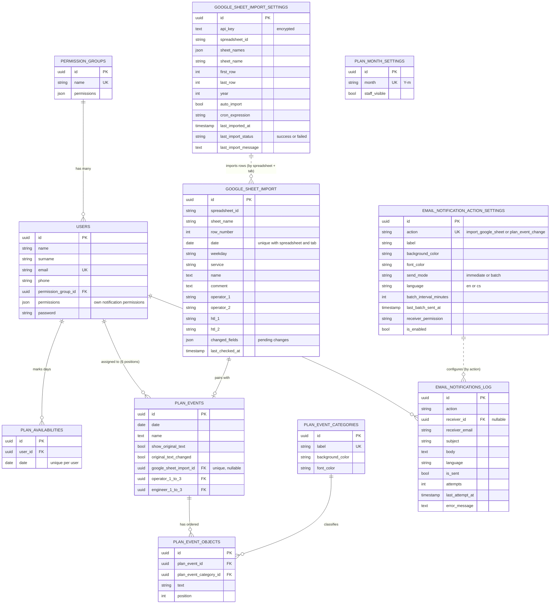
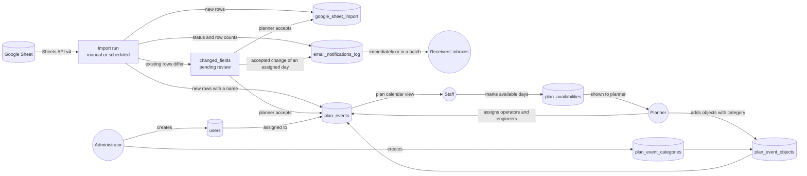

# Laravel Rudolfinum

Internal planning tool for the technical staff of an event venue. It imports the monthly event schedule from a Google Sheet, lets planners enrich every event with categorised objects, assign operators and engineers to it, and lets staff mark the days they have time to work.

The application is a server-driven SPA: Laravel renders pages through Inertia, React renders them in the browser.

## Table of contents

- [Features](#features)
- [Tech stack](#tech-stack)
- [Getting started](#getting-started)
- [Configuration](#configuration)
- [Users, permission groups and permissions](#users-permission-groups-and-permissions)
- [Pages and routes](#pages-and-routes)
- [Domain model](#domain-model)
- [Flows (end-to-end diagrams)](#flows-end-to-end-diagrams)
- [Google Sheets import in short](#google-sheets-import-in-short)
- [Scheduler and Artisan commands](#scheduler-and-artisan-commands)
- [API documentation](#api-documentation)
- [Project structure](#project-structure)
- [Testing and quality checks](#testing-and-quality-checks)
- [Deployment notes](#deployment-notes)

## Features

| Area                 | What it does                                                                                                                                                                                                                                                                                                                                                                                                                                                                                                                                                                                                                                                                                                                             |
| -------------------- | ---------------------------------------------------------------------------------------------------------------------------------------------------------------------------------------------------------------------------------------------------------------------------------------------------------------------------------------------------------------------------------------------------------------------------------------------------------------------------------------------------------------------------------------------------------------------------------------------------------------------------------------------------------------------------------------------------------------------------------------- |
| Authentication       | Email and password login, rate limited (5 failed attempts per email and IP).                                                                                                                                                                                                                                                                                                                                                                                                                                                                                                                                                                                                                                                             |
| Accounts             | Administrators create, edit and delete accounts, assign a permission group and reset passwords.                                                                                                                                                                                                                                                                                                                                                                                                                                                                                                                                                                                                                                          |
| Permissions          | Access is controlled by nine permissions (seven open pages and actions, two only make a user receive an email notification) bundled into permission groups and enforced with Laravel gates on every route.                                                                                                                                                                                                                                                                                                                                                                                                                                                                                                                               |
| Calendar             | Plain month calendar (Monday based) with month navigation.                                                                                                                                                                                                                                                                                                                                                                                                                                                                                                                                                                                                                                                                               |
| Plan calendar view   | Read-only list of every day of a month with its events, objects and (optionally) staff. Users mark the days they have time to work.                                                                                                                                                                                                                                                                                                                                                                                                                                                                                                                                                                                                      |
| Plan calendar edit   | Planners add events by hand, add and reorder categorised objects, assign up to 3 operators and 3 engineers per event and show or hide staff for a month.                                                                                                                                                                                                                                                                                                                                                                                                                                                                                                                                                                                 |
| Plan categories      | Administrators manage categories (label, background and font colour) used by event objects.                                                                                                                                                                                                                                                                                                                                                                                                                                                                                                                                                                                                                                              |
| Google Sheets import | Saved import definitions (spreadsheet, tab, row range, year, schedule). Manual or scheduled runs create plan events and detect later changes in the sheet.                                                                                                                                                                                                                                                                                                                                                                                                                                                                                                                                                                               |
| Email notifications  | A log of emails (`email_notifications_log`) created by actions, in English or Czech. Every notification has its own settings: name with colors (also used in the log), sending (immediately or in a batch with its interval), language, the permission of its receivers and an enabled switch. The first action is the Google Sheets import, which by default notifies users with the `importGoogleSheet.notification` permission about its status and the new, changed and unchanged rows. The second one tells the operators and engineers assigned to a day, who have the `planEventChange.notification` permission, that an accepted import change altered it. Administrators manage the log and settings on `/email-notifications`. |
| Change review        | Differences found by later imports are held back until a planner accepts them, one row or all rows at once.                                                                                                                                                                                                                                                                                                                                                                                                                                                                                                                                                                                                                              |

## Tech stack

| Layer                  | Technology                                                                                           |
| ---------------------- | ---------------------------------------------------------------------------------------------------- |
| Backend                | PHP 8.3+ (CI runs 8.5), Laravel 13                                                                   |
| Frontend bridge        | Inertia.js v3 (`inertiajs/inertia-laravel`, `@inertiajs/react`), SSR enabled in `config/inertia.php` |
| Frontend               | React 19, TypeScript, Material UI 9, React Compiler                                                  |
| Bundler                | Vite+ (`vp`) with `laravel-vite-plugin`, `@inertiajs/vite` and Wayfinder                             |
| Typed routes           | Laravel Wayfinder (generated into `resources/js/routes` and `resources/js/actions`)                  |
| Database               | SQLite by default (`DB_CONNECTION=sqlite`), UUID primary keys                                        |
| Sessions, cache, queue | `database` drivers                                                                                   |
| Tests                  | Pest 5                                                                                               |
| Static analysis, style | Larastan (level 7), Laravel Pint, `vp check`                                                         |
| External service       | Google Sheets API v4 (read only, API key)                                                            |

## Getting started

### Requirements

- PHP 8.3 or newer with the SQLite extension
- Composer 2
- Node.js 22 and npm

### Installation

```bash
composer setup        # install PHP deps, create .env, generate key, migrate, npm install, build assets
php artisan db:seed   # permission groups, default categories and demo users (optional, local only)
composer dev          # server, queue listener, log tail (pail) and Vite
```

The application is then available at <http://localhost:8000>.

`composer dev` runs `php artisan dev`, which starts `serve`, `queue:listen`, `pail` and `npm run dev`. It does **not** start the scheduler. To test scheduled Google Sheet imports locally, run this in another terminal:

```bash
php artisan schedule:work
```

Emails go to a local [Mailpit](https://mailpit.axllent.org) server: SMTP on port `1025` (`MAIL_MAILER=smtp`, `MAIL_PORT=1025` in `.env`) and the inbox UI on <http://localhost:8025>.

### Seeded demo data

`php artisan db:seed` creates:

| Group          | Users                           |
| -------------- | ------------------------------- |
| Administrators | `michal.virt@gmail.com`         |
| Planners       | `ivo.mechel@highlite.cz`        |
| Viewers        | six demo users (`@example.net`) |

Every seeded user has the password `password` (set by `UserFactory`). **Never seed production with these accounts.** Default categories seeded: Koncert, Zkouška, Instalace.

### Useful commands

| Command                               | Purpose                                                   |
| ------------------------------------- | --------------------------------------------------------- |
| `composer dev`                        | Run the whole local development stack.                    |
| `npm run build`                       | Build frontend assets.                                    |
| `npm run build:ssr`                   | Build client and SSR bundles.                             |
| `composer lint`                       | Fix PHP code style with Pint.                             |
| `composer types:check`                | Run PHPStan (Larastan).                                   |
| `npm run check` / `npm run check:fix` | Lint and format the frontend with Vite+.                  |
| `npm run types:check`                 | TypeScript type check.                                    |
| `composer test`                       | Pint check, PHPStan and the Pest suite.                   |
| `composer ci:check`                   | Everything CI runs (frontend checks and `composer test`). |

## Configuration

Copy `.env.example` to `.env` (done by `composer setup`). The settings that matter most for this project:

| Variable                       | Default                     | Description                                                                              |
| ------------------------------ | --------------------------- | ---------------------------------------------------------------------------------------- |
| `APP_URL`                      | `http://localhost:8000`     | Base URL of the application.                                                             |
| `DB_CONNECTION`                | `sqlite`                    | Database driver. SQLite file lives in `database/database.sqlite`.                        |
| `SESSION_DRIVER`               | `database`                  | Required for the "sign out other sessions on password reset" behaviour.                  |
| `QUEUE_CONNECTION`             | `database`                  | Queue driver. No application jobs are queued at the moment.                              |
| `GOOGLE_SHEETS_API_KEY`        | empty                       | Default Google API key, stored with an import when it is saved without a key of its own. |
| `MAIL_*`                       | Mailpit on `127.0.0.1:1025` | Mail server used by the email notifications.                                             |
| `GOOGLE_SHEETS_SPREADSHEET_ID` | empty                       | Default spreadsheet id offered in the import form.                                       |

### Google API key

1. In Google Cloud, enable the **Google Sheets API** and create an **API key**.
2. Share the spreadsheet as **Anyone with the link can view** (an API key can only read public sheets).
3. Put the key in `.env` as the default, or paste it in the import form. When an import is saved, the key used (submitted, already saved, or the default from `.env`, in this order) is stored with the import. Stored keys are **encrypted** (`encrypted` cast) and are never sent back to the browser (`hidden` attribute, only `hasApiKey` is exposed).

## Users, permission groups and permissions

A user belongs to at most one permission group. A group holds a list of permissions (JSON column cast to the `App\Enums\Permission` enum). `AppServiceProvider` registers one gate per permission, and `routes/web.php` protects routes with `can:<permission>` middleware. A user without a group has no permissions.

The notification permissions (values ending with `.notification`, `Permission::notifications()`) can also be set on a single user (`users.permissions`, JSON), on top of the group. Administrators set them on `/accounts`: per user in the account dialog and per group in the "Notifications per permission group" table. A user has a permission when the user or the group has it, and a user who has a notification permission both ways still gets only one email.

| Permission                       | Grants                                                                                                                                                                                                           |
| -------------------------------- | ---------------------------------------------------------------------------------------------------------------------------------------------------------------------------------------------------------------- |
| `calendar.view`                  | Open the calendar page.                                                                                                                                                                                          |
| `plan-calendar.view`             | Open the plan calendar view and mark own availability.                                                                                                                                                           |
| `plan-calendar.edit`             | Open the plan calendar editor: events, objects, assignments, staff visibility.                                                                                                                                   |
| `plan-categories.manage`         | Manage plan event categories.                                                                                                                                                                                    |
| `plan-import.manage`             | Manage Google Sheets imports and accept changes.                                                                                                                                                                 |
| `accounts.manage`                | Manage accounts and reset passwords.                                                                                                                                                                             |
| `email-notifications.manage`     | Manage the email notification log and settings.                                                                                                                                                                  |
| `importGoogleSheet.notification` | Default permission to receive the email notification after every Google Sheets import (changeable per notification).                                                                                             |
| `planEventChange.notification`   | Default permission to receive the email notification when an accepted import change alters a day the user is assigned to as operator or engineer in a month shown in the plan calendar view. Every group has it. |

Seeded groups (`PermissionGroupFactory`):

| Group          | Permissions                                                                                 |
| -------------- | ------------------------------------------------------------------------------------------- |
| Administrators | all nine                                                                                    |
| Planners       | `calendar.view`, `plan-calendar.view`, `plan-calendar.edit`, `planEventChange.notification` |
| Viewers        | `calendar.view`, `plan-calendar.view`, `planEventChange.notification`                       |

The authenticated user and permission values are shared with every page as the `auth` Inertia prop, and the navigation in `resources/js/layouts/app-layout.tsx` is filtered by them.

In production, `Password::defaults()` requires 12+ characters with mixed case, letters, numbers, symbols and not being compromised. Elsewhere, Laravel's default rules apply.

## Pages and routes

All routes live in `routes/web.php`. Pages are Inertia components in `resources/js/pages`.

| URL                    | Page component        | Permission                   | Purpose                            |
| ---------------------- | --------------------- | ---------------------------- | ---------------------------------- |
| `/`                    | `welcome`             | public                       | Home                               |
| `/login`               | `login`               | guest                        | Login form                         |
| `/calendar`            | `calendar`            | `calendar.view`              | Month calendar                     |
| `/plan-calendar-view`  | `plan-calendar-view`  | `plan-calendar.view`         | Month plan, availability           |
| `/plan-calendar-edit`  | `plan-calendar-edit`  | `plan-calendar.edit`         | Edit events, objects, assignments  |
| `/plan-categories`     | `plan-categories`     | `plan-categories.manage`     | Categories CRUD                    |
| `/plan-import`         | `plan-import`         | `plan-import.manage`         | Imports, changes review            |
| `/email-notifications` | `email-notifications` | `email-notifications.manage` | Notification log, settings, resend |
| `/accounts`            | `accounts`            | `accounts.manage`            | Accounts CRUD                      |
| `/up`                  | n/a                   | public                       | Laravel health check               |

The full list of endpoints (including every mutation) is in [`docs/API.md`](docs/API.md) and [`docs/openapi.yaml`](docs/openapi.yaml). Run `php artisan route:list --except-vendor` to inspect them live.

## Domain model



Key rules enforced by the schema:

- A sheet row is unique per `(spreadsheet_id, sheet_name, date)`.
- A plan event is paired with at most one imported row (`google_sheet_import_id` is unique). Events added by hand have no pair.
- Deleting a user sets that user's event positions to `NULL`, deletes the user's availability days and keeps the user's email log rows with `receiver_id = NULL`.
- Deleting an event deletes its objects. A category in use cannot be deleted (`restrictOnDelete`).
- Deleting an import setting does **not** delete imported rows or plan events.
- `PlanMonthSetting` is independent: a month without a row has its staff hidden in the plan calendar view.
- `EmailNotificationActionSetting` holds one row per `EmailNotificationAction` (`action` is unique). A missing row is created with defaults the first time it is needed. Log rows reference the action by its value, not by a foreign key.

## Flows (end-to-end diagrams)

Every flow has its own document with a sequence diagram, a state or flow diagram, validation rules, permissions and edge cases. Diagrams are written in [Mermaid](https://mermaid.js.org/), which GitHub, GitLab and most IDEs render natively.

| Flow                                                 | Document                                                                     |
| ---------------------------------------------------- | ---------------------------------------------------------------------------- |
| Import from Google Sheets (configure, run, schedule) | [`docs/flows/google-sheets-import.md`](docs/flows/google-sheets-import.md)   |
| Accept changes between imports                       | [`docs/flows/accept-import-changes.md`](docs/flows/accept-import-changes.md) |
| Create a user (and manage accounts)                  | [`docs/flows/create-user.md`](docs/flows/create-user.md)                     |
| Create categories (and use them on events)           | [`docs/flows/create-categories.md`](docs/flows/create-categories.md)         |
| Assign an event to a user                            | [`docs/flows/assign-event-to-user.md`](docs/flows/assign-event-to-user.md)   |
| Email notifications (log, batch sending, templates)  | [`docs/flows/email-notifications.md`](docs/flows/email-notifications.md)     |

### The big picture



## Google Sheets import in short

- An **import setting** points at one tab of one spreadsheet, a row range (default rows 15 to 40), the year the sheet belongs to, and an optional cron schedule (default `0 * * * *`).
- Columns read (A to J): `A` date (`d.m.` or `d.m.Y`), `B` weekday, `C` service, `D` event name, `E` comment, `F` operator 1, `G` operator 2, `H` ignored, `I` HTL 1, `J` HTL 2.
- The first run creates rows and, for rows with an event name, plan events. Later runs never overwrite accepted data, they only record differences in `changed_fields` until a planner accepts them.
- Rows without a valid or unique date are skipped and reported as a warning.
- Every run (manual, CLI or scheduled) creates an email notification about its result, see [`docs/flows/email-notifications.md`](docs/flows/email-notifications.md).

Details: [`docs/flows/google-sheets-import.md`](docs/flows/google-sheets-import.md) and [`docs/flows/accept-import-changes.md`](docs/flows/accept-import-changes.md).

## Scheduler and Artisan commands

`routes/console.php` schedules `google-sheet:import` **every minute** without overlapping. The command itself decides which imports are due by evaluating each import's cron expression.

```bash
php artisan google-sheet:import            # run every automatic import that is due now
php artisan google-sheet:import <uuid>     # run one saved import right now (ignores auto_import and cron)
php artisan email-notifications:send       # send the waiting email notifications when the batch interval has passed
php artisan email-notifications:send --force  # send them now
```

`email-notifications:send` is also scheduled every minute. Waiting rows of notifications set to send immediately are always sent. Rows of notifications set to send in a batch are sent only when the interval of the notification (default 5 minutes) has passed. Failed rows are not retried automatically, an administrator resends them on `/email-notifications`.

`google-sheet:import` exits with a non-zero code when the import id does not exist or an import fails. One failing import does not stop the others. `email-notifications:send` always exits with zero.

In production, add the standard Laravel scheduler entry:

```cron
* * * * * cd /path/to/app && php artisan schedule:run >> /dev/null 2>&1
```

## API documentation

The application has no separate REST API. Every endpoint is a session-authenticated web route that either renders an Inertia page, redirects after a mutation, or (one endpoint) returns JSON.

- [`docs/API.md`](docs/API.md): human-readable reference, conventions, authentication, error handling and every endpoint.
- [`docs/openapi.yaml`](docs/openapi.yaml): OpenAPI 3.1 specification.
- [`docs/swagger.html`](docs/swagger.html): Swagger UI that renders the specification.

View the Swagger UI locally (the spec is fetched over HTTP, so opening the HTML file directly will not work):

```bash
php -S localhost:8081 -t docs
# open http://localhost:8081/swagger.html
```

## Project structure

```text
app/
  Console/Commands/
    ImportGoogleSheet.php                  google-sheet:import command
    SendEmailNotifications.php             email-notifications:send command
  Enums/                                   Permission, ImportStatus, EmailNotification*
  Http/
    Controllers/                           thin, mostly single-action controllers
    Middleware/HandleInertiaRequests.php   shared props (auth, app name)
    Requests/                              Form Requests: validation and cross-field rules
  Mail/EmailNotificationMail.php           plain text mail with a rendered subject and body
  Models/                                  UUID models with typed @property docs
  Providers/AppServiceProvider.php         permission gates, password defaults
  Services/
    EmailNotifier.php                      create, send and resend email notifications
    GoogleSheetImporter.php                fetch, parse, diff and accept sheet rows
    PlanCalendarBuilder.php                builds the month payload for the plan pages
bootstrap/app.php                          routing, middleware, JSON exception rendering
config/services.php                        google_sheets defaults
database/
  factories/, seeders/, migrations/
docs/                                      API reference, OpenAPI, Swagger UI, flow diagrams
lang/{en,cs}/email_notifications.php       email notification templates
resources/js/
  pages/                                   Inertia pages (React + MUI)
  components/, layouts/, types/
  routes/, actions/                        generated by Wayfinder (do not edit)
resources/views/                           app.blade.php (Inertia root), mail/email-notification.blade.php
routes/web.php                             all HTTP routes
routes/console.php                         scheduler
tests/Feature/                             Pest feature tests per area
```

Conventions worth knowing:

- Validation lives in Form Requests, including multi-field rules (assignment conflicts, object ordering).
- Controllers query Eloquent directly; the three services (`GoogleSheetImporter`, `PlanCalendarBuilder`, `EmailNotifier`) hold the non-trivial logic.
- Mutating actions return `back()` with an Inertia flash message (`success` or `warning`). Failures are `ValidationException`s so the UI shows them next to the form.
- Frontend code calls the backend through Wayfinder functions (`@/routes`, `@/actions`) instead of hardcoded URLs. Regenerate with `php artisan wayfinder:generate` (also done by the Vite plugin).

## Testing and quality checks

```bash
php artisan test --compact                      # whole suite
php artisan test --compact tests/Feature/PlanImportTest.php
vendor/bin/pint --dirty --format agent          # format changed PHP files
```

Feature tests cover authentication, permissions, accounts, notification permissions of users and groups, categories, calendar pages, plan editing, availability, staff visibility, the import UI, the `google-sheet:import` command, email notifications and the user seeder. Google requests are faked with `Http::fake()`.

CI (`.github/workflows`) runs `composer setup` and `composer ci:check` on PHP 8.5 and Node 22.

## Deployment notes

- Build assets with `npm run build` (or `npm run build:ssr` if SSR is used; SSR URL is configured in `config/inertia.php`).
- Run `php artisan migrate --force` and seed permission groups and categories (`PermissionGroupSeeder`, `PlanEventCategorySeeder`) once. Create the first administrator manually or with a one-off seeder, not with the demo users.
- Add the scheduler cron entry shown above, or Google Sheet imports will never run automatically.
- Use a strong `APP_KEY`, `APP_DEBUG=false` and keep `SESSION_DRIVER=database` if you rely on password resets signing users out.
- Laravel Cloud deployment is supported through the `deploying-to-cloud` skill in `.cursor/skills`.
