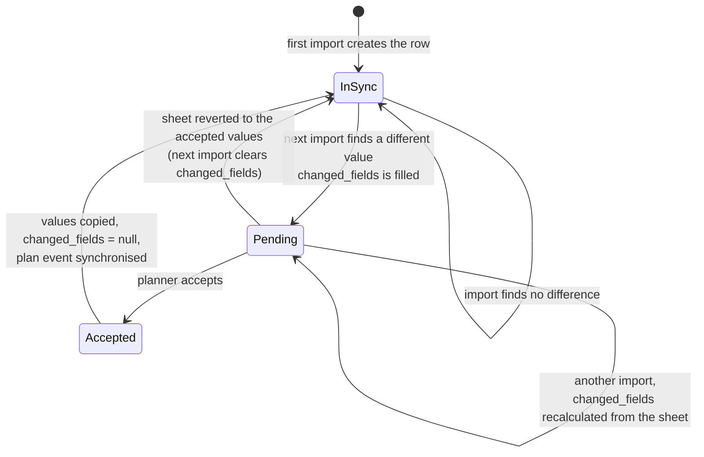
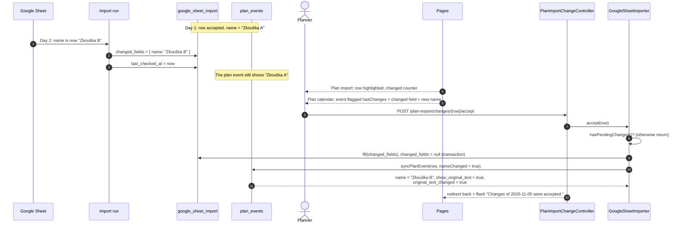
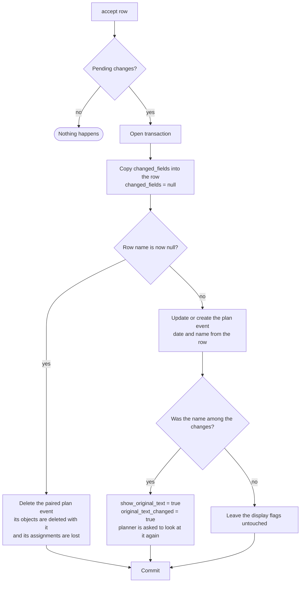
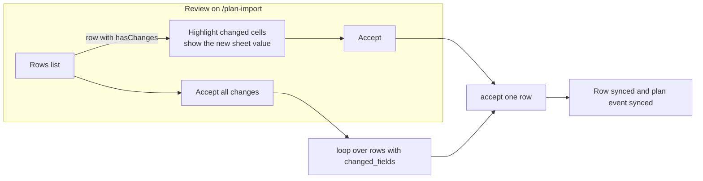
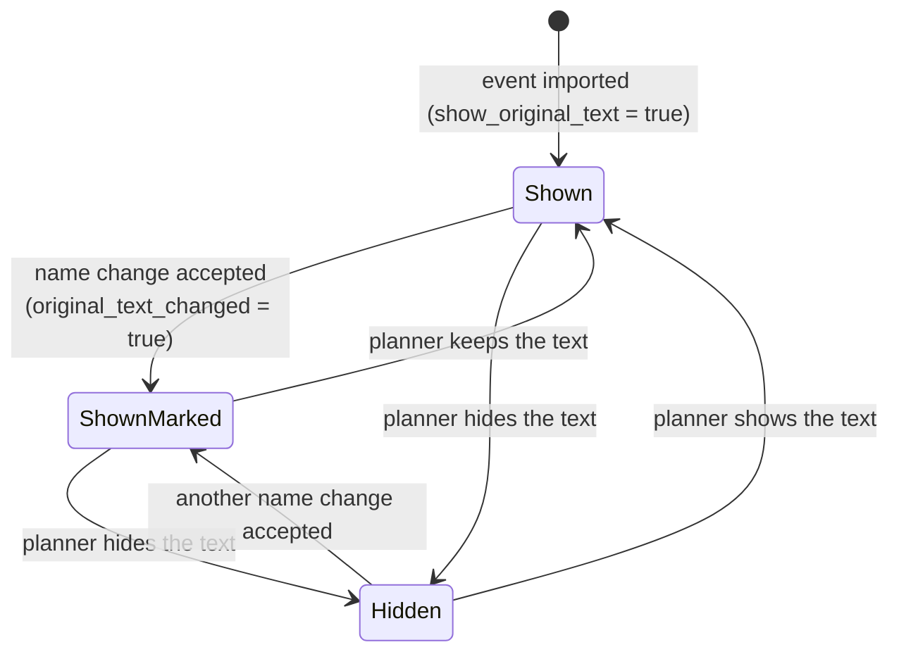

# Flow: Accept changes between imports

When an import finds that a stored row differs from the sheet, it does not overwrite anything. The differences are held in `google_sheet_import.changed_fields` until a planner accepts them. Accepting copies the sheet values into the stored row and synchronises the paired plan event.

|           |                                                                                                                       |
| --------- | --------------------------------------------------------------------------------------------------------------------- |
| Actor     | User with `plan-import.manage`                                                                                        |
| Page      | `/plan-import` (review), plan calendar view and editor (flags)                                                        |
| Endpoints | `POST /plan-import/changes/{googleSheetImport}/accept`, `POST /plan-import/{googleSheetImportSetting}/changes/accept` |
| Code      | `PlanImportChangeController`, `GoogleSheetImporter::accept()` and `syncPlanEvent()`, `PlanEventController::update()`  |
| Tables    | `google_sheet_import`, `plan_events`                                                                                  |

There is no "reject" action. Not accepting leaves the accepted values in place; if the sheet is changed back, the next import clears the pending change.

## 1. Lifecycle of a row



`changed_fields` holds only the fields that differ, as `field => value now in the sheet` (a `null` value means the cell was emptied). Example:

```json
{ "name": "Koncert Česká filharmonie", "comment": null }
```

## 2. End-to-end sequence



## 3. What accepting does to the plan event



Notes:

- Only the **name** is copied to the plan calendar. Weekday, service, comment, operators and HTL values live on the imported row and are shown on `/plan-import`.
- Objects and operator/engineer assignments of a plan event survive an accepted rename. They are lost only when the accepted name is empty, because the event is then deleted.
- If an imported row without a name later receives one and the change is accepted, the plan event is created at that moment.

## 4. Accept one row or all rows

| Action         | Endpoint                                                      | Behaviour                                                                                                                                                                |
| -------------- | ------------------------------------------------------------- | ------------------------------------------------------------------------------------------------------------------------------------------------------------------------ |
| Accept one row | `POST /plan-import/changes/{googleSheetImport}/accept`        | Accepts the changes of one row, flash `Changes of <date> were accepted.` A row without pending changes is a no-op.                                                       |
| Accept all     | `POST /plan-import/{googleSheetImportSetting}/changes/accept` | Finds every row of the import's spreadsheet and tab with `changed_fields` and accepts them one by one (each in its own transaction). Flash `Accepted changes of N rows.` |



## 5. Marks the planners see after accepting

When an accepted change renames an event, the plan event gets `show_original_text = true` and `original_text_changed = true`. The plan calendar then shows the event name with a "changed" mark. A planner resolves it with `PUT /plan-events/{planEvent}` and `show_original_text` set to `true` or `false`; this also resets `original_text_changed` to `false`, whichever decision is made.



### Confirmation by the assigned users

In the plan calendar view the orange row and the "changed" flag are shown **only to a user assigned to the event** (operator or engineer), and only until that user confirms. The row then has an **I know about the change** button (`POST /plan-events/{planEvent}/change-acknowledgement`, code `PlanEventChangeAcknowledgementController`, table `plan_event_change_acknowledgements`).

- The confirmation is per user: other assigned users still see their own flag, and `original_text_changed` stays set for the planners.
- The flag does not depend on the month's staff visibility, so an assigned user is told even when the staff is hidden.
- Confirmations are forgotten when another accepted change renames the event, or when a planner decides about the text.
- A user who is not assigned gets `403`; an event without a changed text is ignored.

Hiding the original text lets planners replace the imported name in the plan calendar view by the categorised objects they built for the event.

## 6. Notification of the assigned staff

After accepting, when the month of the day is shown in the plan calendar view ("Show operators and engineers in view") and the day's plan event has operators or engineers assigned, each of them who has the receiver permission of the notification (`planEventChange.notification` by default) gets an email about the change, unless the notification is disabled, see [email-notifications.md](email-notifications.md).

## 7. Edge cases

| Case                                       | Behaviour                                                                                                          |
| ------------------------------------------ | ------------------------------------------------------------------------------------------------------------------ |
| Accept a row with no pending changes       | Silently ignored, flash still says accepted.                                                                       |
| Two imports run before the planner accepts | `changed_fields` is recalculated against the accepted values each time, so it always shows the latest sheet state. |
| Sheet value reverted before acceptance     | Next import sets `changed_fields = null`, counted as unchanged.                                                    |
| Row removed from the sheet                 | Nothing is flagged or deleted.                                                                                     |
| Accept all with nothing pending            | Flash `Accepted changes of 0 rows.`                                                                                |
| User without `plan-import.manage`          | 403 on both accept endpoints.                                                                                      |
