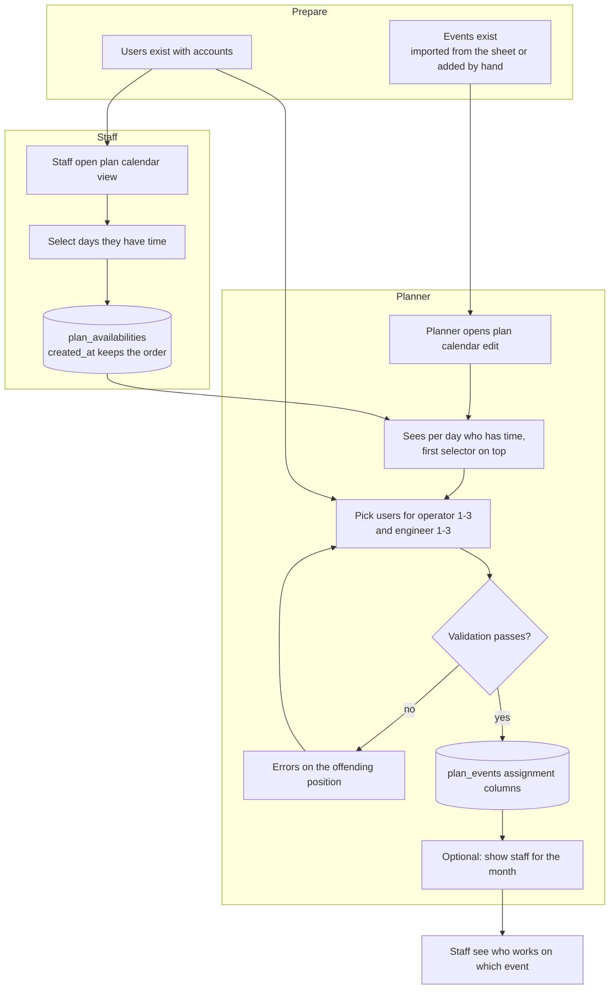
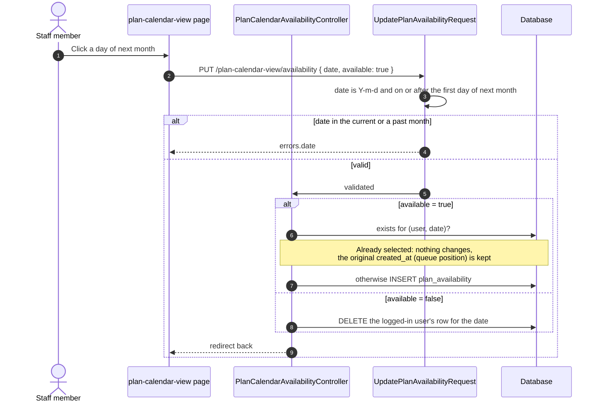
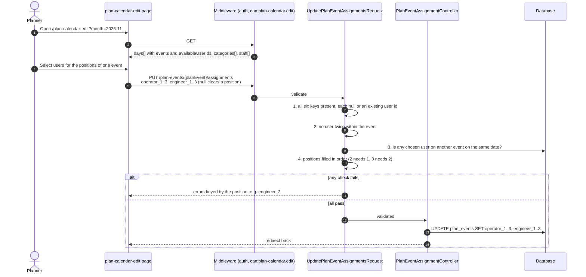
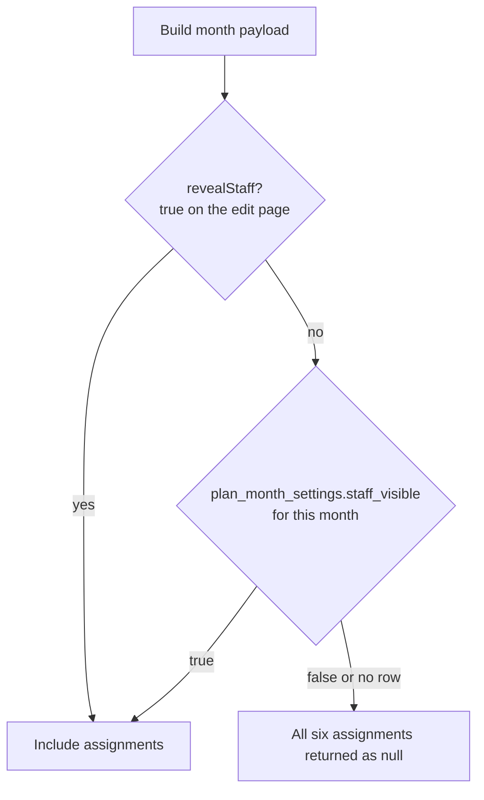
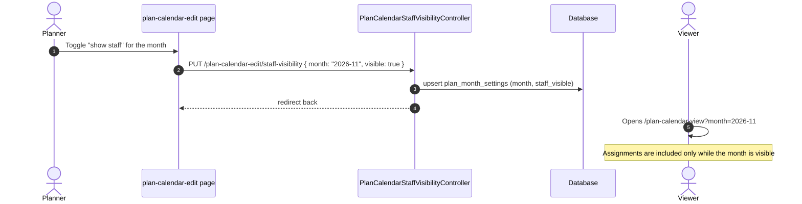
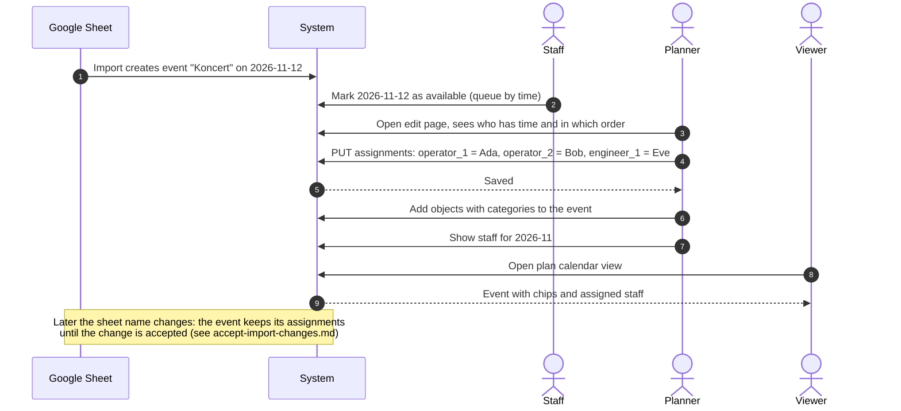

# Flow: Assign an event to a user

Planners staff every event with up to **3 operators** and **3 engineers**. To help them decide, staff first mark the days they have time to work, and the plan calendar shows those users per day (the first to select a day is listed first).

|           |                                                                                                                                                                                                             |
| --------- | ----------------------------------------------------------------------------------------------------------------------------------------------------------------------------------------------------------- |
| Actors    | Staff (mark availability), planners (assign), administrators (everything)                                                                                                                                   |
| Pages     | `/plan-calendar-view`, `/plan-calendar-edit`                                                                                                                                                                |
| Endpoints | `PUT /plan-calendar-view/availability`, `PUT /plan-events/{planEvent}/assignments`, `PUT /plan-calendar-edit/staff-visibility`                                                                              |
| Code      | `PlanCalendarAvailabilityController`, `UpdatePlanAvailabilityRequest`, `PlanEventAssignmentController`, `UpdatePlanEventAssignmentsRequest`, `PlanCalendarStaffVisibilityController`, `PlanCalendarBuilder` |
| Tables    | `plan_availabilities`, `plan_events`, `plan_month_settings`, `users`                                                                                                                                        |

## 1. End-to-end overview

## 2. Step 1: staff mark the days they have time

Rules:

- Requires `plan-calendar.view`. A user always changes **only their own** days.
- Only days from the first day of the **next month** onwards can be changed. The current month is already being planned.
- One row per user and date (unique index). Deleting a user deletes their days.
- The selection time is the queue: `PlanCalendarBuilder` orders `availableUserIds` by `created_at`, so the earliest selector is listed first.

## 3. Step 2: the planner assigns users to an event

### Validation (`UpdatePlanEventAssignmentsRequest`)

| Check                                                         | Error message                                                     |
| ------------------------------------------------------------- | ----------------------------------------------------------------- |
| Every position key must be sent (`present`), `null` clears it | validation "must be present"                                      |
| Value is a user id that exists                                | `exists:users,id`                                                 |
| A user can hold only one position of one event                | _A user can be assigned to only one position of an event._        |
| A user cannot be on two events of the same day                | _This user is already assigned to another event on the same day._ |
| Operators and engineers fill from the first position          | _Select the previous position first._                             |

The same user may work on events of **different** days, and may be freed for another event of the day by unassigning them first. The availability list is a hint only: assigning a user who did not select the day is allowed.

### Positions

| Group     | Columns                                  | Max |
| --------- | ---------------------------------------- | --- |
| Operators | `operator_1`, `operator_2`, `operator_3` | 3   |
| Engineers | `engineer_1`, `engineer_2`, `engineer_3` | 3   |

Each column is a foreign key to `users.id` with `nullOnDelete`: when a user account is deleted, their positions become empty.

> Do not confuse these with the `operator_1`, `operator_2`, `htl_1`, `htl_2` columns of `google_sheet_import`. Those are free text copied from the sheet and are not linked to accounts.

## 4. Step 3: who is allowed to see the staff

Operators and engineers are sensitive until the plan is final, so each month has a switch.

- The planner always sees assignments on the edit page.
- The plan calendar view hides them until the month is switched on. A month without a setting is hidden.

## 5. Complete timeline for one event

## 6. Edge cases

| Case                                                     | Behaviour                                           |
| -------------------------------------------------------- | --------------------------------------------------- |
| Assign a user to both operator and engineer of one event | Rejected, one position per event.                   |
| Assign a user already on another event the same day      | Rejected on that position.                          |
| Fill `operator_3` while `operator_2` is empty            | Rejected: _Select the previous position first._     |
| Omit a position key in the request                       | Validation error, send `null` to clear.             |
| Assigned user deleted                                    | The position becomes empty, the event stays.        |
| Accepted import change renames the event                 | Assignments are kept.                               |
| Accepted import change empties the name                  | The event, its objects and assignments are deleted. |
| User without `plan-calendar.edit`                        | 403 on the assignment and visibility endpoints.     |
| Mark availability for the current month                  | Rejected, only following months are open.           |
