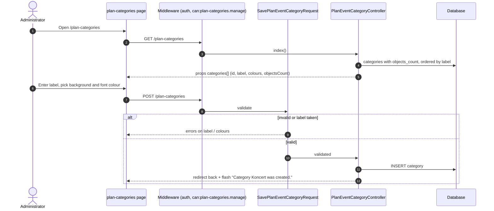
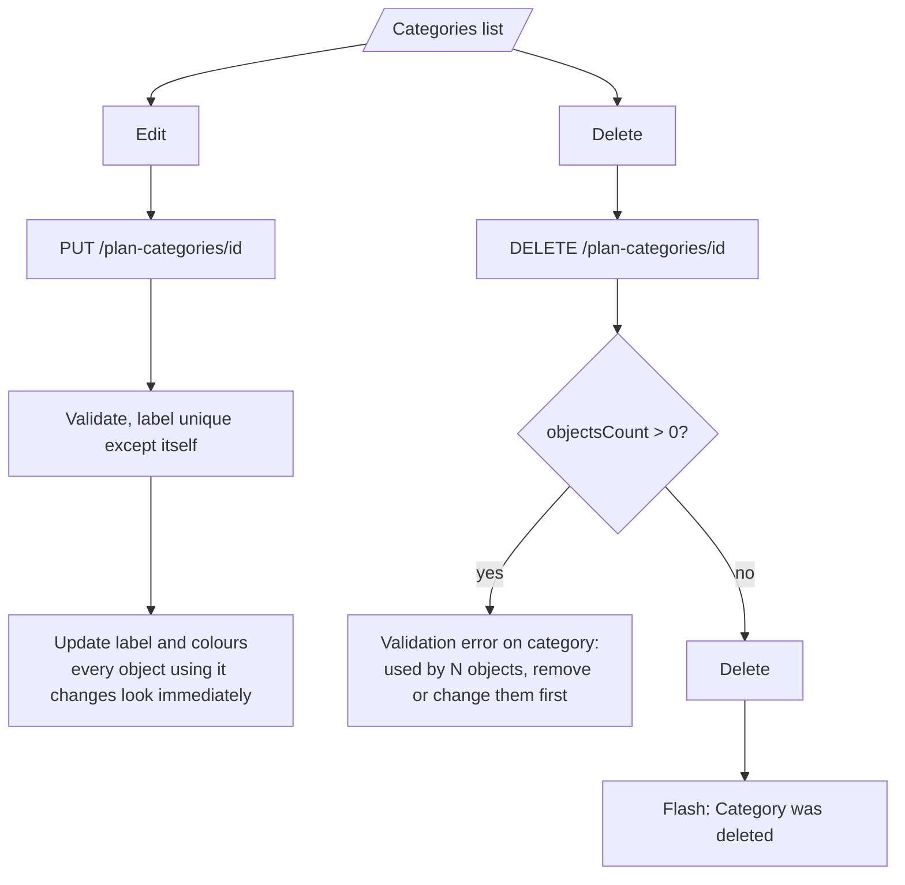
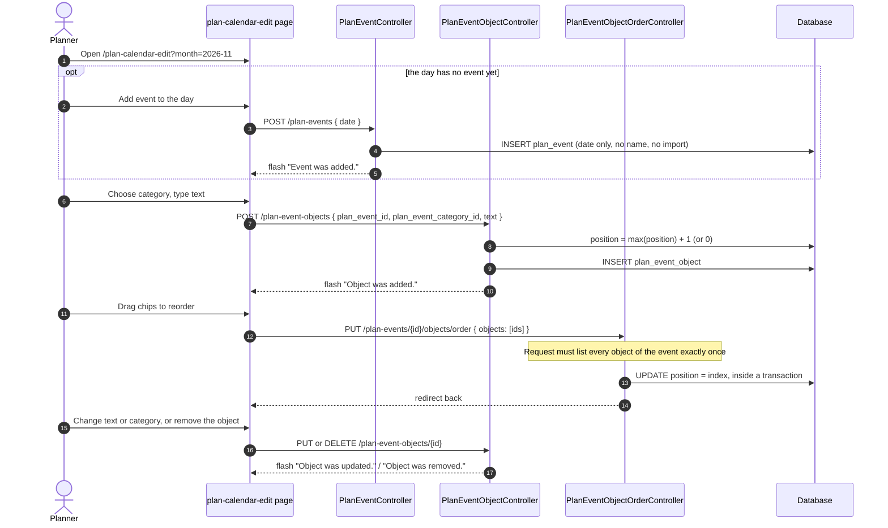
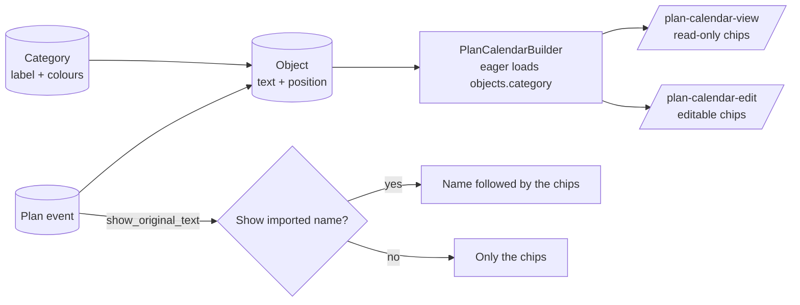

# Flow: Create categories

Categories give a label and a colour pair to the **objects** planners attach to a plan event (for example a concert, a rehearsal or an installation). An object is a short text plus a category, shown as a coloured chip behind the event name.

|           |                                                                                                                                                                                   |
| --------- | --------------------------------------------------------------------------------------------------------------------------------------------------------------------------------- |
| Actor     | Categories: user with `plan-categories.manage`. Objects: user with `plan-calendar.edit`                                                                                           |
| Pages     | `/plan-categories`, `/plan-calendar-edit`                                                                                                                                         |
| Endpoints | `GET/POST /plan-categories`, `PUT /plan-categories/{id}`, `DELETE /plan-categories/{id}`, `POST/PUT/DELETE /plan-event-objects...`, `PUT /plan-events/{id}/objects/order`         |
| Code      | `PlanEventCategoryController`, `SavePlanEventCategoryRequest`, `PlanEventObjectController`, `SavePlanEventObjectRequest`, `PlanEventObjectOrderController`, `PlanCalendarBuilder` |
| Tables    | `plan_event_categories`, `plan_event_objects`                                                                                                                                     |

## 1. Create a category

### Validation (`SavePlanEventCategoryRequest`)

| Field              | Rules                                                                                 |
| ------------------ | ------------------------------------------------------------------------------------- |
| `label`            | required, string, max 100, unique among categories (an update may keep its own label) |
| `background_color` | required, hex colour `#RRGGBB`                                                        |
| `font_color`       | required, hex colour `#RRGGBB`                                                        |

Seeded defaults (`PlanEventCategorySeeder`, idempotent by label):

| Label     | Background | Font      |
| --------- | ---------- | --------- |
| Koncert   | `#1565c0`  | `#ffffff` |
| Zkouška   | `#2e7d32`  | `#ffffff` |
| Instalace | `#ef6c00`  | `#000000` |

## 2. Edit and delete

The database also protects this rule: `plan_event_objects.plan_event_category_id` is `restrictOnDelete`.

## 3. Using a category: add objects to an event

Categories are only useful once they are used on events. Planners open `/plan-calendar-edit`, which loads every day of a month with its events, the list of categories and the list of staff.

### Object validation (`SavePlanEventObjectRequest`)

| Field                    | Rules                                                                                             |
| ------------------------ | ------------------------------------------------------------------------------------------------- |
| `plan_event_id`          | required on create, must exist. Ignored on update, so an object cannot be moved to another event. |
| `plan_event_category_id` | required, must exist                                                                              |
| `text`                   | required, string, max 255                                                                         |

## 4. How it ends up in the plan calendar

Objects are sorted by `position`, then `created_at`, then `id`. The category payload sent to the frontend is `{ id, label, background_color, font_color }`.

## 5. Edge cases

| Case                                                    | Behaviour                                                          |
| ------------------------------------------------------- | ------------------------------------------------------------------ |
| Duplicate label (case sensitivity follows the database) | Validation error, nothing created.                                 |
| Colour not in `#RRGGBB` form (for example `#fff`)       | Validation error.                                                  |
| Delete a category used by objects                       | Blocked with a message that includes the count.                    |
| Delete a manual event                                   | Its objects are deleted with it (cascade).                         |
| Delete an imported event                                | 403, imported events cannot be removed.                            |
| Reorder request with a missing, extra or duplicated id  | Validation error on `objects`.                                     |
| User with only `plan-calendar.edit`                     | Can use categories on events but cannot create or edit categories. |
