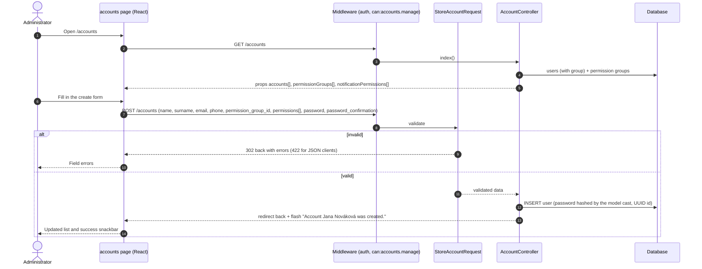
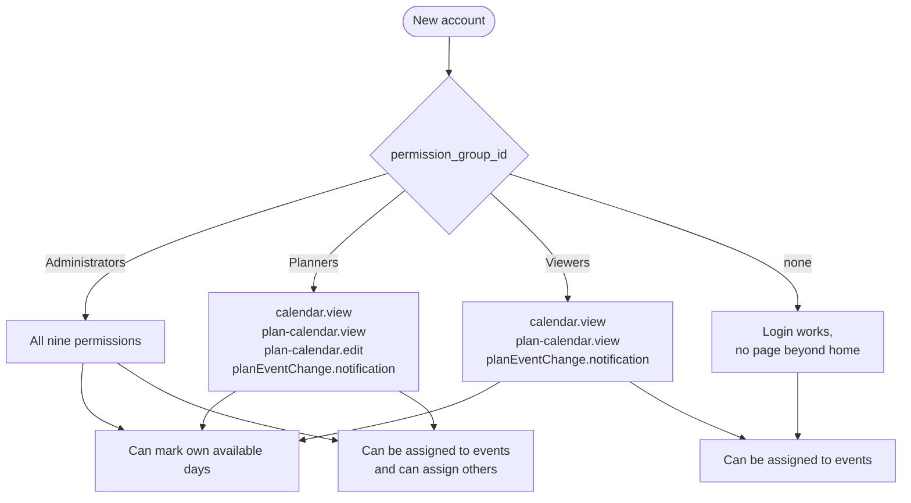
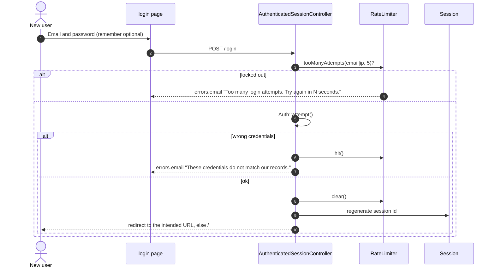
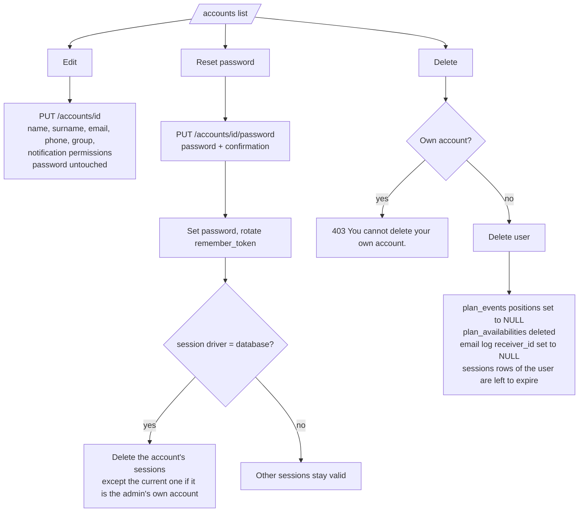

# Flow: Create a user

Administrators manage accounts on `/accounts`. There is no self-registration, no email verification and no password reset by email: an administrator creates the account and sets the password.

|           |                                                                                                                                                                                                                                          |
| --------- | ---------------------------------------------------------------------------------------------------------------------------------------------------------------------------------------------------------------------------------------- |
| Actor     | User with `accounts.manage` (Administrators by default)                                                                                                                                                                                  |
| Page      | `/accounts`                                                                                                                                                                                                                              |
| Endpoints | `POST /accounts`, `PUT /accounts/{account}`, `PUT /accounts/{account}/password`, `DELETE /accounts/{account}`, `PUT /permission-groups/{permissionGroup}/notification-permissions`                                                       |
| Code      | `AccountController`, `AccountPasswordController`, `StoreAccountRequest`, `UpdateAccountRequest`, `ResetAccountPasswordRequest`, `PermissionGroupNotificationPermissionController`, `UpdatePermissionGroupNotificationPermissionsRequest` |
| Tables    | `users`, `permission_groups`, `sessions`                                                                                                                                                                                                 |

Besides the group, the dialog sets the notification permissions (`*.notification`, for example `importGoogleSheet.notification`, `planEventChange.notification`) of the account. The same permissions of a whole group are set in the "Notifications per permission group" table of the page (`PUT /permission-groups/{permissionGroup}/notification-permissions`, only the notification permissions of the group change). A user who has a notification permission both ways receives one email, see [email-notifications.md](email-notifications.md).

## 1. Create an account



If the user lacks the permission the middleware answers `403`; a guest is redirected to `/login`.

### Validation (`StoreAccountRequest`)

| Field                 | Rules                                                                                                             |
| --------------------- | ----------------------------------------------------------------------------------------------------------------- |
| `name`                | required, string, max 255                                                                                         |
| `surname`             | required, string, max 255                                                                                         |
| `email`               | required, valid email, max 255, unique in `users`                                                                 |
| `phone`               | optional, string, max 255                                                                                         |
| `permission_group_id` | optional, must exist in `permission_groups`                                                                       |
| `permissions`         | optional list of notification permissions (values ending with `.notification`), no duplicates. Missing means none |
| `password`            | required, must match `password_confirmation`, `Password::defaults()`                                              |

`Password::defaults()` is Laravel's default (min 8) outside production. In production it requires at least 12 characters with mixed case, letters, numbers, symbols and not appearing in known data breaches.

A user created **without** a permission group can log in but has no permissions (every protected page returns 403).

## 2. What the new user can do



Every account, whatever its group, appears in the assignable staff list (`PlanCalendarBuilder::staff()`), see [assign-event-to-user.md](assign-event-to-user.md).

## 3. First sign-in



Logged-in users are redirected away from `/login` (guest middleware). `POST /logout` invalidates the session and regenerates the CSRF token.

## 4. Manage the account afterwards



| Action         | Notes                                                                                                                                                                                           |
| -------------- | ----------------------------------------------------------------------------------------------------------------------------------------------------------------------------------------------- |
| Edit           | Email uniqueness ignores the account being edited. Sending an empty `permission_group_id` removes the user's group. A missing `permissions` removes the account's own notification permissions. |
| Reset password | Same password rules as create. Signs the user out everywhere (database sessions only).                                                                                                          |
| Delete         | An administrator cannot delete themselves, which prevents locking everyone out.                                                                                                                 |

## 5. Seeding users from the command line

`php artisan db:seed` creates the default groups, categories and demo users (see the README). For a production bootstrap, create the first administrator with a one-off command such as:

```bash
php artisan tinker --execute 'App\Models\User::create(["name" => "Ada", "surname" => "Admin", "email" => "ada@example.com", "password" => "a-strong-password", "permission_group_id" => App\Models\PermissionGroup::where("name", "Administrators")->value("id")]);'
```

The `PermissionGroupSeeder` must have run first.
