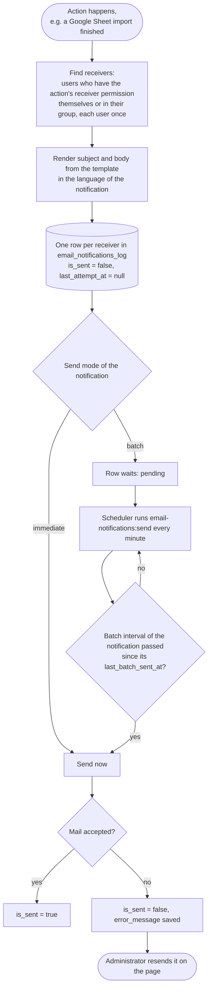
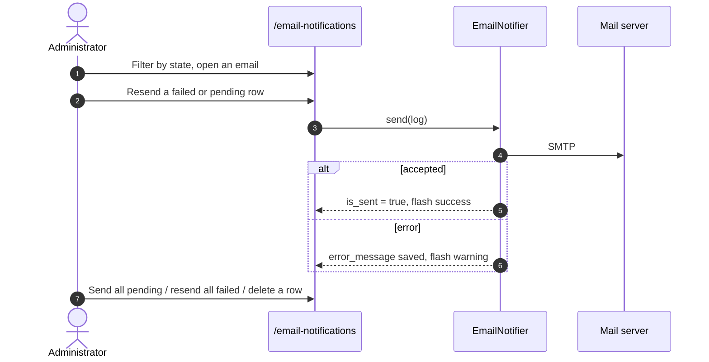

# Flow: Email notifications

Informs users by email about what happened in the application and keeps a log of every email.

|                   |                                                                                                                                                                                                                                       |
| ----------------- | ------------------------------------------------------------------------------------------------------------------------------------------------------------------------------------------------------------------------------------- |
| Actor             | Receivers get the emails. Users with `email-notifications.manage` (Administrators by default) manage the log and the settings.                                                                                                        |
| Page              | `/email-notifications`                                                                                                                                                                                                                |
| Code              | `EmailNotifier`, `EmailNotificationMail`, `SendEmailNotifications` command, `EmailNotificationController`, `EmailNotificationSendController`, `EmailNotificationActionSettingController`, `SaveEmailNotificationActionSettingRequest` |
| Tables            | `email_notifications_log`, `email_notification_action_settings`                                                                                                                                                                       |
| Templates         | `lang/en/email_notifications.php`, `lang/cs/email_notifications.php`, plain text view `resources/views/mail/email-notification.blade.php`                                                                                             |
| Local mail server | [Mailpit](https://mailpit.axllent.org): SMTP `127.0.0.1:1025`, UI <http://localhost:8025>                                                                                                                                             |

## 1. Overview

A notification never fails the action that created it: an error while creating or sending is caught (and reported to the log), the import still finishes.

## 2. The log table

| Column                                         | Meaning                                                                                                   |
| ---------------------------------------------- | --------------------------------------------------------------------------------------------------------- |
| `action`                                       | What created the notification (`import_google_sheet`, `plan_event_change`), see `EmailNotificationAction` |
| `receiver_id`, `receiver_email`                | The user (set to `NULL` when the user is deleted) and the address used at that time                       |
| `subject`, `body`                              | The rendered text, exactly what is sent. Resending sends the stored text                                  |
| `language`                                     | Language the text was rendered in                                                                         |
| `is_sent`                                      | `true` when the mail was accepted by the mail server                                                      |
| `attempts`, `last_attempt_at`, `error_message` | How many sends were tried, when, and the error of the last failed one                                     |

State shown on the page: **sent** (`is_sent`), **failed** (not sent, `last_attempt_at` set) and **pending** (never attempted, waiting for the batch).

## 3. Settings

Every notification has its own row in `email_notification_action_settings`, edited on the page. The page lists the notifications with a switch (enabled), the name in its colors, the sending style (with the interval in batch mode), the language and an edit icon that opens a dialog with every setting. A row is created with the defaults the first time it is needed. The previous application-wide language, interval and sending mode were moved to the row of the Google Sheets import by the migrations.

| Setting                          | Values                                                                                                         | Default                                                |
| -------------------------------- | -------------------------------------------------------------------------------------------------------------- | ------------------------------------------------------ |
| `label`                          | The name of the action, up to 100 characters                                                                   | `EmailNotificationAction::defaultLabel()`              |
| `background_color`, `font_color` | Hex colors (`#rrggbb`) of the name. Used for the name in the settings list and in the action column of the log | `#1565c0`, `#ffffff`                                   |
| `send_mode`                      | `immediate`, `batch`                                                                                           | `batch`                                                |
| `batch_interval_minutes`         | 1 to 1440, used in batch mode                                                                                  | 5                                                      |
| `language`                       | `en`, `cs`: the language of the template                                                                       | `en`                                                   |
| `receiver_permission`            | Any `Permission`: users who have it themselves or whose group has it receive the notification, once            | `EmailNotificationAction::defaultReceiverPermission()` |
| `is_enabled`                     | `true`, `false`. A disabled notification creates no log rows and sends nothing                                 | `true`                                                 |
| `last_batch_sent_at`             | Set by the command, not editable                                                                               | `null`                                                 |

`php artisan email-notifications:send` runs every minute and goes through the notifications one by one. It always sends the waiting rows of a notification set to `immediate` (for example when the mode was changed after the rows were created). It sends the waiting rows of a `batch` notification only when its `batch_interval_minutes` have passed since its `last_batch_sent_at`; `--force` ignores the interval. Failed rows are not retried automatically.

## 4. Templates

Each action has a template per outcome in `lang/{language}/email_notifications.php` with `:placeholders`. Add a new language by adding the folder and the value to `EmailNotificationLanguage`.

| Template                      | Placeholders                                                                                               |
| ----------------------------- | ---------------------------------------------------------------------------------------------------------- |
| `import_google_sheet.success` | `:sheet`, `:status`, `:created`, `:changed`, `:unchanged`, `:skipped`                                      |
| `import_google_sheet.failed`  | `:sheet`, `:status`, `:message`                                                                            |
| `plan_event_change.changed`   | `:date`, `:name`, `:changes` (one `field: old -> new` line per changed field, field names from `fields.*`) |

## 5. Add a new action

Add a case to `EmailNotificationAction` with `defaultLabel()` and `defaultReceiverPermission()`, add its templates (section 4) and call the private `EmailNotifier::notify()` from a public method. The settings row appears on the page by itself.

## 6. First action: Google Sheets import

`GoogleSheetImporter::import()` creates the notifications after every run, manual (`/plan-import`), CLI or scheduled.

- **Receivers:** every user who has the receiver permission of the notification, `importGoogleSheet.notification` by default, set on the user or on the user's permission group (Administrators by default). A user with the permission in both places receives one notification.
- **Content:** import status (success or failed), the tab, the counts of new, changed and unchanged rows, skipped rows, or the error message when the import failed.

## 7. Second action: plan event change

`GoogleSheetImporter::accept()` creates the notifications when a planner accepts the change of a day (one row, or every row with "accept all", see [accept-import-changes.md](accept-import-changes.md)).

- **Condition:** the month of the day is shown in the plan calendar view (`plan_month_settings.staff_visible`, "Show operators and engineers in view") and at least one operator or engineer is assigned to the day's plan event.
- **Receivers:** the operators and engineers assigned to the day (up to 3 + 3, each once) who also have the receiver permission of the notification, `planEventChange.notification` by default, set on the user or on the user's group. Nobody else is notified.
- **Content:** the date, the name of the event and every changed field with its old and new value.
- **Permission:** the seeded permission groups include `planEventChange.notification`.

## 8. Manage notifications

## 9. Permissions

| Permission                       | Effect                                                                                            |
| -------------------------------- | ------------------------------------------------------------------------------------------------- |
| `email-notifications.manage`     | Open the page, change the notification settings, send, resend and delete rows                     |
| `importGoogleSheet.notification` | Default receiver permission of the Google Sheets import emails (does not give access to the page) |
| `planEventChange.notification`   | Default receiver permission of the plan event change emails (does not give access to the page)    |

Notification permissions are set on `/accounts`: per user in the account dialog and per group in the "Notifications per permission group" table, see [create-user.md](create-user.md). The seeded Administrators group includes `email-notifications.manage` and `importGoogleSheet.notification`.
