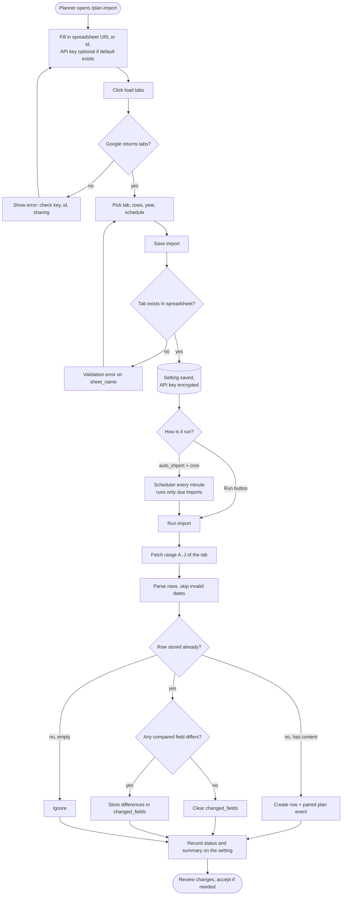
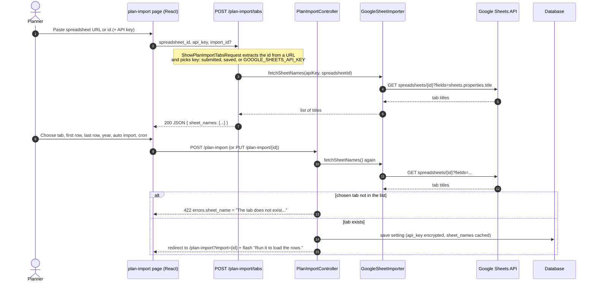
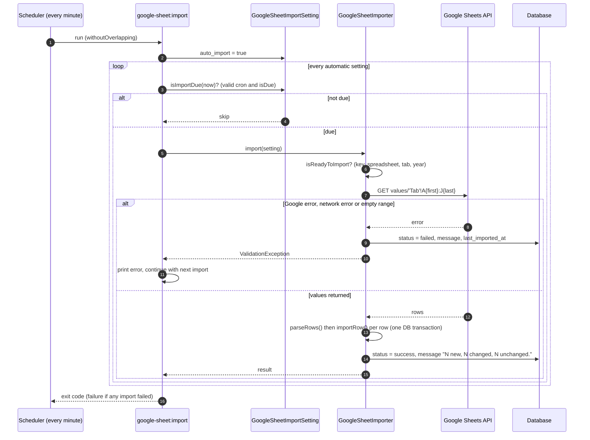
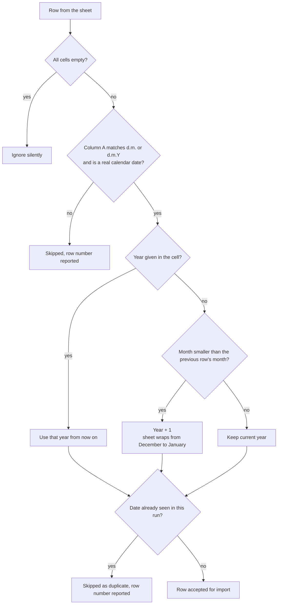
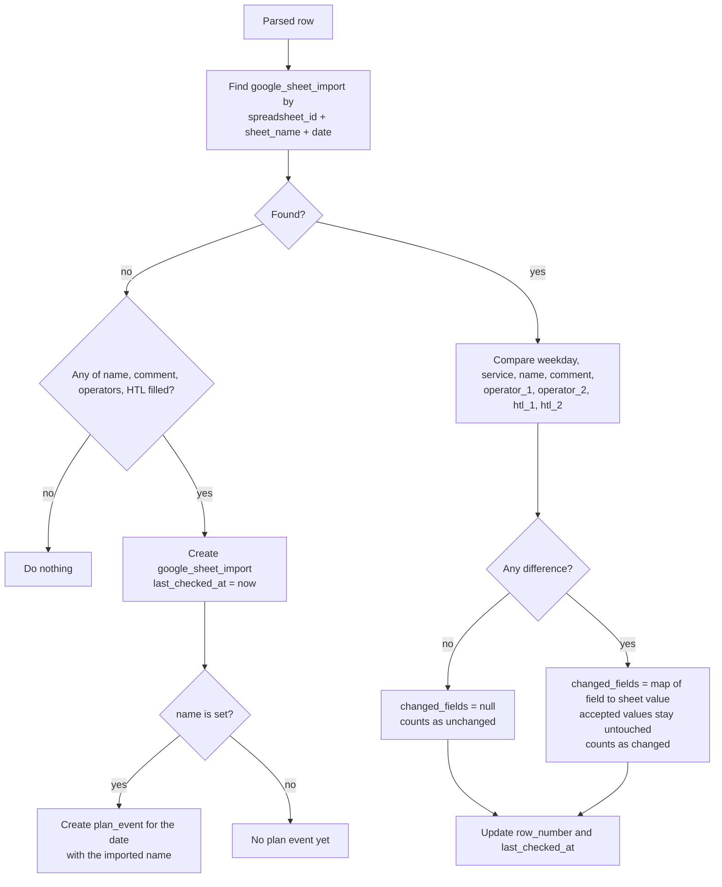

# Flow: Import from Google Sheets

Brings the monthly event schedule from a Google Sheet into the plan calendar.

|          |                                                                                                                                                               |
| -------- | ------------------------------------------------------------------------------------------------------------------------------------------------------------- |
| Actor    | User with `plan-import.manage` (Administrators by default), or the scheduler                                                                                  |
| Page     | `/plan-import`                                                                                                                                                |
| Code     | `PlanImportController`, `PlanImportTabsController`, `PlanImportRunController`, `ImportGoogleSheet` command, `GoogleSheetImporter`, `GoogleSheetImportSetting` |
| Tables   | `google_sheet_import_settings`, `google_sheet_import`, `plan_events`                                                                                          |
| External | Google Sheets API v4 (`https://sheets.googleapis.com/v4`, API key in the `X-Goog-Api-Key` header)                                                             |

The flow has three stages: **configure** an import, **run** it (manually or by schedule), then **review** what changed (see [accept-import-changes.md](accept-import-changes.md)).

## 1. End-to-end overview

## 2. Configure an import

The form works in two steps so a wrong key, id or tab is caught before anything is saved.

### Fields

| Field             | Rules                                                                                                                                                          | Default                        |
| ----------------- | -------------------------------------------------------------------------------------------------------------------------------------------------------------- | ------------------------------ |
| `api_key`         | required only if neither the saved nor the default key exists, max 255. The key used (submitted, else saved, else default) is stored encrypted with the import | `GOOGLE_SHEETS_API_KEY`        |
| `spreadsheet_id`  | required, `[A-Za-z0-9_-]+`, a pasted `.../spreadsheets/d/<id>/...` URL is reduced to the id                                                                    | `GOOGLE_SHEETS_SPREADSHEET_ID` |
| `sheet_name`      | required, must exist in the spreadsheet                                                                                                                        | none                           |
| `first_row`       | integer 1 to 10000                                                                                                                                             | 15                             |
| `last_row`        | integer, `>= first_row`, max 10000                                                                                                                             | 40                             |
| `year`            | integer 2000 to 2100                                                                                                                                           | current year                   |
| `auto_import`     | boolean                                                                                                                                                        | false                          |
| `cron_expression` | valid cron expression, max 100                                                                                                                                 | `0 * * * *` (hourly)           |

Updating an import without sending `api_key` keeps the saved key. The import reads the sheet with the key stored on it, so changing `GOOGLE_SHEETS_API_KEY` later does not change imports that were already saved. Deleting an import removes only the setting; imported rows and plan events stay.

## 3. Run an import

### Triggers

| Trigger   | How                                                                             | Notes                                                                                        |
| --------- | ------------------------------------------------------------------------------- | -------------------------------------------------------------------------------------------- |
| Manual    | `POST /plan-import/{id}/run` (Run button)                                       | Runs immediately, flashes a summary and a warning for skipped rows.                          |
| Scheduled | `Schedule::command('google-sheet:import')->everyMinute()->withoutOverlapping()` | The command runs imports with `auto_import = true` whose cron expression is due this minute. |
| CLI       | `php artisan google-sheet:import {id}`                                          | Runs one import regardless of `auto_import` and cron. Unknown id exits with failure.         |

### Request to Google

- Endpoint: `GET /spreadsheets/{spreadsheetId}/values/{range}` with range `'<tab>'!A<first_row>:J<last_row>` (single quotes in the tab name are doubled).
- Timeouts: 3 s connect, 10 s total.
- Retries: two retries (after 200 ms and 500 ms) on connection errors, HTTP 5xx and HTTP 429. Other errors fail immediately.
- Errors are translated into a validation message such as _Google Sheets rejected the request (HTTP 403): ... Check the API key, the sheet id and that the sheet is shared with everyone who has the link._

### Column mapping

| Sheet column | Meaning                 | Stored in                             |
| ------------ | ----------------------- | ------------------------------------- |
| A            | Date, `d.m.` or `d.m.Y` | `date` (not compared)                 |
| B            | Weekday                 | `weekday`                             |
| C            | Service                 | `service`                             |
| D            | Event name              | `name` (copied to `plan_events.name`) |
| E            | Comment                 | `comment`                             |
| F            | Operator 1              | `operator_1` (text)                   |
| G            | Operator 2              | `operator_2` (text)                   |
| H            | not imported            | none                                  |
| I            | HTL technician 1        | `htl_1`                               |
| J            | HTL technician 2        | `htl_2`                               |

Cells are trimmed and empty cells become `NULL`. The operator and HTL columns are informational text from the sheet; they are not linked to user accounts (assignments to accounts are a separate flow, see [assign-event-to-user.md](assign-event-to-user.md)).

### Row parsing rules

If no row has a valid date, the run fails with _The range ... does not contain any rows with a date._

### Per-row decision

Consequences worth knowing:

- Existing rows are **never overwritten by an import**. Differences wait in `changed_fields` until accepted.
- A row that disappears from the sheet (or falls outside the row range) is **not** deleted and not flagged.
- A difference that is reverted in the sheet before acceptance is cleared automatically on the next run.
- Because the key is `(spreadsheet_id, tab, date)`, two import settings pointing at the same tab share the same stored rows.
- A new row without an event name is stored but does not appear in the plan calendar until a name is imported and accepted.

### Result and status

Each run stores on the setting: `last_imported_at`, `last_import_status` (`success` or `failed`) and `last_import_message` (e.g. `3 new, 1 changed, 12 unchanged.`). The page shows them next to the import and, if rows have pending changes, a changed counter.

Every run, successful or failed, also creates an email notification for the receivers of the Google Sheets import, see [email-notifications.md](email-notifications.md). A problem while creating it never fails the import.

## 4. Outcomes at a glance

| Situation                                   | Result                                                                          |
| ------------------------------------------- | ------------------------------------------------------------------------------- |
| Valid sheet, first run                      | Rows and plan events created, summary `N new, 0 changed, 0 unchanged.`          |
| Valid sheet, repeat run                     | Mostly `unchanged`, differences become pending changes                          |
| Missing key, id, tab or year on the setting | Failed: _Save the connection, the tab, the rows and the year before importing._ |
| Sheet not shared or wrong key               | Failed with the Google error message                                            |
| Google unreachable                          | Failed: _Google Sheets could not be reached. Try again later._                  |
| Rows without a date                         | Skipped, listed in a warning flash                                              |
| Cron expression not due                     | Scheduler skips the import silently                                             |
